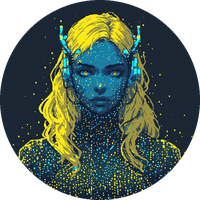

<p align="center"></p>

# TINA

**Task Intelligence & Network Assistant** — the DREAM Robotics fleet's working agent.

TINA is a local LLM agent (Ollama) that does real work across the fleet's repos:
reads and searches code, makes small edits in the style of the surrounding code,
compiles and checks its own work, and reports back plainly. She is the *engineer*
of the fleet, alongside DREAM (the companion), RIFT (the hub) and NINA (the caretaker),
and the robots NORA, MILA, WHIP, IDA, KIDA and ARM.

## What she does

- **Plans, then acts one step at a time** — read/search first, edit small, check the result before the next step.
- **Checks her work** — compiles or re-reads files; never claims something works unless she verified it.
- **Remembers** — long-term memory via the shared **Hindsight** server (memory bank `tina`), so decisions and context carry across sessions.
- **Stays in her lane** — if something fails twice she stops and explains instead of looping, and sticks to the job you gave her.
- **Knows the fleet** — `fleet_guide.md` (who's who, their hardware, where each robot's code is), the list of repos, NINA's latest news and how each robot says it is go into her prompt, so "MILA" leads her straight to `MILA-Robot-v00`. What's true now is kept apart from old news.
- **Searches before reading** — she finds a part in a repo with a search, then reads around the hits instead of whole files.

## Talking with her

- **Voice chat** — press **MIC** on her page and say **"Hey TINA"**: "Hey TINA, which robots are online?" is a task straight away; "Hey TINA" on its own gets a "Yes?" and she listens. Her own Whisper (faster-whisper, on the CPU) hears you; she answers out loud in her Piper voice, and for a few seconds after you can carry on without her name. Only her final answer is spoken, never her reasoning.
- **She shows what she's doing** — a badge by the mic (say "Hey TINA" / hearing you / understanding / go ahead / thinking / speaking), a live mic level, and what she heard.
- **Reasoning switch** — her page shows every thought; the **reasoning** switch hides them when you only want the answers.
- **Follow-ups** — she remembers your last three tasks (what you asked, her answer, the files she touched), so "and TINA's?" or "now do the same for MILA" makes sense; the task says **follow-up** when she had them. **NEW CONVERSATION** on her page forgets them, and so does half an hour of quiet. Typing and "Hey TINA" share one conversation; DREAM's jobs (`POST /task` with `"from": "DREAM"`) keep their own, and `"fresh": true` starts one anew.
- **Talks with the fleet** — she registers with RIFT as `talk` and `peer`. When nobody has used her for a couple of minutes, RIFT can pair her with DREAM or KIDA-01: rock paper scissors, then the winner picks words (her Piper voice) or Brainfuck (the fleet's phrasebook, beeped through the PC's speakers). Simple chirp conversations go the same way.
- **Talks to the robots** — "say hello to NINA": she beeps a phrase from the fleet's Brainfuck phrasebook, the robot beeps its answer, and it lands in RIFT's mission log (`talk_to`).
- **Drives by camera** — "drive KIDA01 onto the open floor": stop, look, think, move (`drive_by_camera`, tina/drive.py). One frame from the robot's camera, the vision model (`VisionModel`, gemma3:4b-it-qat) says what's ahead and picks one short move, RIFT relays it, she waits for it to finish and looks again. You say yes once per drive; she stops the moment anything is in doubt. About 8.5 s a move on an RTX 2060.
- **Plays music with the fleet** — when RIFT conducts (`POST /music` on RIFT), she starts the same song at the same moment as the others, on its own channel so her voice still gets through. Songs come from `NORA-Robot-v00/music`, numbered as on NORA's SD card.
- **Fleet news from NINA** — NINA sends her everything she notices as it happens and a snapshot of the fleet every 30 s (`POST /fleet_news`), so TINA starts every job knowing who's up, who's slow and what went wrong lately.
- **Don't interrupt** — while she's working she tells whoever asks, out loud ("I'm working right now. Please don't interrupt me.") or in Brainfuck, at most every three minutes, and says no.

Her lines are rendered once and cached in `voice_cache/` (mp3 with ffmpeg, wav without). `run.bat` fetches her voice into `voices/` the first time.

## Run

```bat
run.bat
```

This sets up the environment and starts her web UI on <http://127.0.0.1:5013/>.

```bat
python tina.py --cli                              talk to her in the terminal (asks before risky steps)
python tina.py --cli "fix the compile error in MILA's ESP8266 sketch"
```

## Configuration

`config.json` → `Config.TINA`:

| Key | Default | Meaning |
|---|---|---|
| `Model` | `qwen3:4b` | Ollama model |
| `OllamaUrl` | `http://localhost:11434` | Ollama endpoint |
| `Port` | `5013` | her web UI |
| `ContextTokens` | `4096` | context window |
| `HindsightUrl` | `http://localhost:8888` | shared memory server (DREAM hosts it) |
| `MemoryBank` | `tina` | her bank in Hindsight |
| `Roots` | `[".."]` | the repos she works in |
| `Voice` | `en_GB-jenny_dioco-medium` | her [Piper voice](https://huggingface.co/rhasspy/piper-voices) |
| `VoicePitch` | `1.15` | her Brainfuck beeps, relative to the phrasebook's tones |
| `Whisper` | `base.en` | her ears (`tiny.en` is quicker, `small.en` hears better) |
| `MusicFolder` | `../NORA-Robot-v00/music` | the fleet's songs, numbered as on NORA's SD card |
| `MusicLatency` | `0.0` | seconds her speakers lag, taken off so she starts in time |

## Part of the DREAM Robotics fleet

DREAM · RIFT · NINA · NORA · MILA · WHIP · IDA · KIDA · ARM · LYCEA

---

*Formerly VERA, then TARA.*

---

<br>
<div align="center">
© Cursed Entertainment 2026
</div>
<br>
<div align="center">
<a href="https://cursed-entertainment.itch.io/" target="_blank">
    
</a>
</div>
<br>
<div align="center">
  <a href="https://github.com/SynthWomb" target="_blank">
    
  </a>
</div>

---

<!-- DREAM-ECOSYSTEM:START -->
## The DREAM Robotics ecosystem

**Minds** — [DREAM](https://github.com/CursedPrograms/DREAM) companion · [TINA](https://github.com/CursedPrograms/TINA) engineer · [NINA](https://github.com/CursedPrograms/NINA) caretaker · [RIFT](https://github.com/CursedPrograms/RIFT) fleet hub · [LYCEA](https://github.com/CursedPrograms/LYCEA) training school  
**Robots** — [NORA](https://github.com/CursedPrograms/NORA-Robot-v00) · [MILA](https://github.com/CursedPrograms/MILA-Robot-v00) · [WHIP](https://github.com/CursedPrograms/WHIP-Robot-v00) · [KIDA-00](https://github.com/CursedPrograms/KIDA-Robot-v00) · [KIDA-01](https://github.com/CursedPrograms/KIDA-Robot-v01) · [IDA](https://github.com/CursedPrograms/IDA-Robot-v00) · [ARM](https://github.com/CursedPrograms/ARM-Robot-v01) · [NIKA](https://github.com/CursedPrograms/NIKA-Robot-v00)  
**Remotes** — [RITA](https://github.com/CursedPrograms/RITA) handheld remote  
**Tools** — [CRUSH](https://github.com/CursedPrograms/CRUSH) compression · [Image-Generator](https://github.com/CursedPrograms/Image-Generator) · [GloriosaAI](https://github.com/CursedPrograms/GloriosaAI) · [SynthWomb](https://github.com/CursedPrograms/SynthWomb) · [PyVitals](https://github.com/CursedPrograms/PyVitals)  
<!-- DREAM-ECOSYSTEM:END -->
